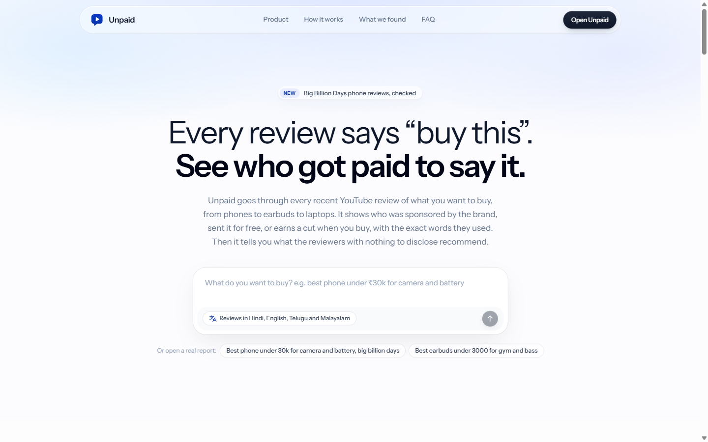
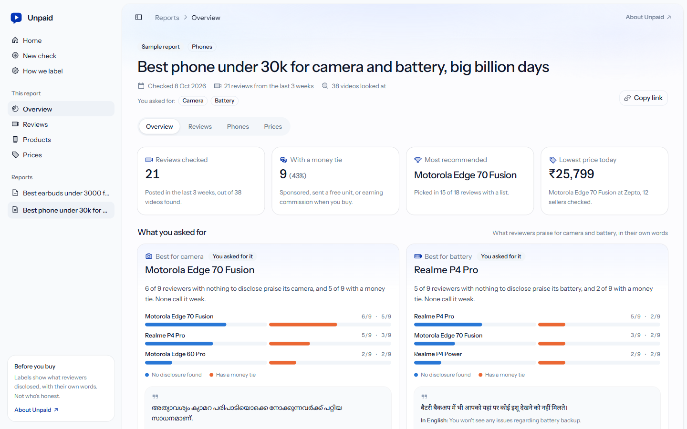
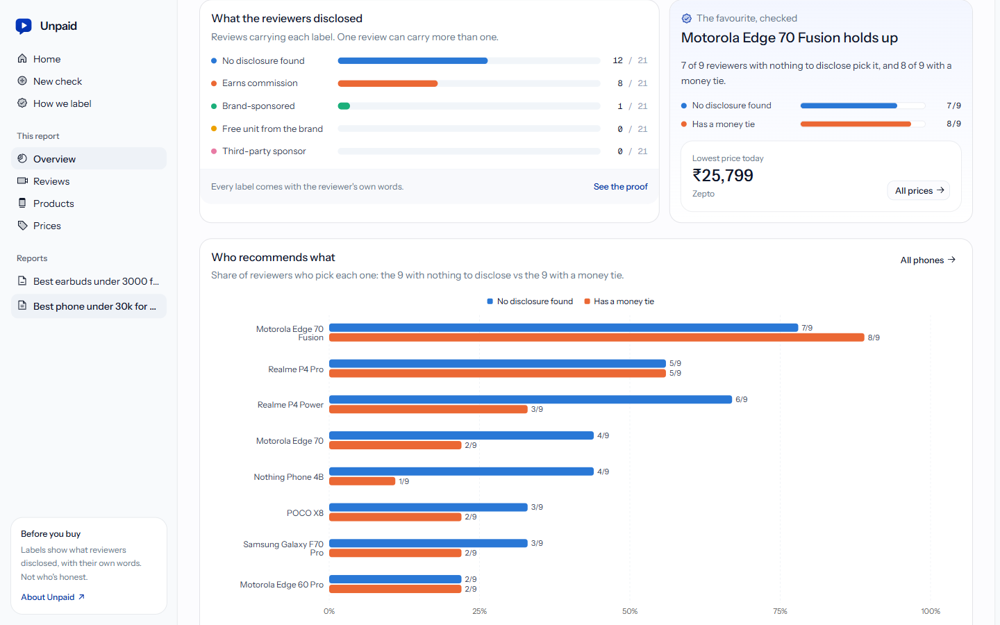
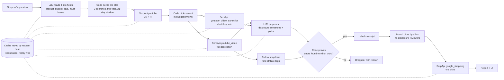
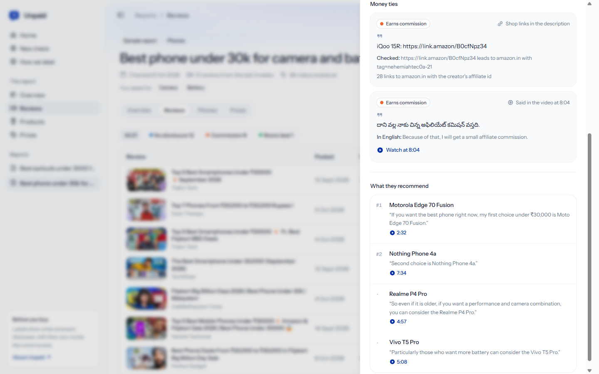

# Unpaid



**[Watch the demo](https://youtu.be/neUM6Qp4lko)** · **[Judge it in 90 seconds](#judge-it-in-90-seconds)** · **[The numbers](#the-numbers)** ·
**[How SerpApi decides the answer](#how-unpaid-uses-serpapi)** · **[Limits](#honesty-limits-and-what-is-real)** ·
**[For judges: hackathon.md](hackathon.md)**

[](https://github.com/rohit-jsfreaky/unpaid/actions/workflows/ci.yml)


**Ask what to buy. Unpaid reads every recent YouTube review of it, through SerpApi, including what reviewers say
out loud. It shows who disclosed a brand deal, a free unit or a commission, and what the reviewers with nothing to
disclose recommend. The AI only finds the sentence; code shows a label only when that exact sentence is in the
video's description or transcript, or YouTube labelled the video itself.**

▶ **Demo video (2:17, the app running locally):** https://youtu.be/neUM6Qp4lko

[](https://youtu.be/neUM6Qp4lko)

Built for the **SerpApi India Hackathon 2026** (track: Commerce & Market Intelligence).

---

## Judge it in 90 seconds

No API keys needed. Every SerpApi response and every AI answer from the real runs is saved in `evidence/`, and the
app replays them for free.

You need [uv](https://docs.astral.sh/uv/getting-started/installation/) and Node.js 22 or newer.

```bash
git clone https://github.com/rohit-jsfreaky/unpaid.git
cd unpaid/engine
uv sync
uv run verify          # 22 PASS lines: every claim in this README, checked from the saved data
uv run unpaid serve    # the API on http://127.0.0.1:8000 (keep this terminal open; the web app talks to it)
```

In a second terminal, from the `unpaid` folder:

```bash
cd web
npm ci
npm run dev            # open http://localhost:3000
```

The first page load in dev mode takes a few seconds while Next.js compiles it.

Then:

1. **http://localhost:3000**: the landing page. Every number and quote on it comes from the saved run.
2. Click **Open Unpaid** (top right). On Home, click a **Try:** question (these are the questions
   already recorded, so they replay with no keys). You'll watch the recorded run play back step by
   step: searching, watching each review, checking shop links, finding money ties, prices.
3. In the report, open **Reviews** and click **Telugu Techno Spring**. The commission label comes from a sentence
   the reviewer *said* in Telugu at 8:04, with an English meaning and a "Watch at 8:04" link to that exact moment.
4. Open **How we label** for the rules and the accuracy table.

What the showcase run found (8 Oct 2026, "best phone under 30k for camera and battery, big billion days"):

| | |
|---|---|
| Recent review videos opened | **21** (of 38 found), 18 with transcripts, in 4 languages |
| Videos with a disclosed money tie | **9** (8 earn commission, 1 brand-sponsored) |
| Different #1 picks across the 21 videos | **10** |
| Label precision on a 21-video answer key | **100%** for Brand-sponsored and Earns commission; commission recall 89% (8 of 9) |
| Favourite of reviewers with nothing to disclose | Motorola Edge 70 Fusion, picked by 7 of 9 (lowest price ₹25,799 at Zepto) |

---

## Contents

- [The problem](#the-problem)
- [What I built](#what-i-built)
- [Architecture](#architecture)
- [The core loop](#the-core-loop)
- [How Unpaid uses SerpApi](#how-unpaid-uses-serpapi)
- [Engineering decisions](#engineering-decisions)
- [The numbers](#the-numbers)
- [Honesty: limits and what is real](#honesty-limits-and-what-is-real)
- [Stack, layout, running it, tests](#stack)
- [Attribution](#attribution)

## The problem

In India, people pick a phone on YouTube. Before every big sale, dozens of "best phone under ₹30,000" videos go up
in a few days, in Hindi, English, Telugu, Malayalam and more. They don't agree. In our recorded run, **21 recent
reviews named 10 different phones as their #1 pick.**

Some of those reviewers are paid. They earn commission on every phone bought through their links, the brand sent
them the phone, or the video is a brand deal. Most of them say so somewhere: in a line deep in the description,
in an affiliate link, or out loud in the middle of the video. **9 of the 21 videos disclosed a money tie**, but you'd
have to read 21 descriptions, follow 64 links and listen to hours of video in four languages to find them.

Price tools help you pay less for the phone. Nothing tells you whether the advice to buy it was paid for.

## What I built

1. **Ask in plain words.** "best phone under 30k for camera and battery, big billion days", or "best earbuds under
   3000 for gym and bass". Any product works, not just phones.
2. **Find every recent review.** YouTube search through SerpApi, in English and Hindi. Keep videos from the last 3
   weeks whose title names your budget. Every dropped video says why.
3. **Watch each one.** The full description and the transcript of each video, in the language the reviewer spoke.
4. **Check every shop link.** Follow each link in the description, without buying, to see if it carries the
   reviewer's own affiliate tag (`tag=` on Amazon, `affid=` on Flipkart).
5. **Find money ties.** The AI proposes sentences; code checks each one. Five labels: **Brand-sponsored**, **Free
   unit from the brand**, **Earns commission**, **Third-party sponsor**, **No disclosure found**.
6. **What they recommend, and what each product is good at.** Each reviewer's picks, with their own words and a
   timestamp. For your must-haves (camera, battery, bass…) the best product as rated by reviewers with nothing
   to disclose, compared with everyone.
7. **Today's prices.** Google Shopping through SerpApi for the top picks, the cheapest offer per seller.
8. **A report you can check.** Overview, Reviews (every quote with a "Watch at" link), Products, Prices.





## Architecture



**Data model** (`engine/src/unpaid/board.py`, mirrored in `web/lib/types.ts`):

- `Report`: question, checked_at, searches, `reviews[]` (date, views, length, caption language), `videos[]`,
  `board`, `areas[]`, `prices[]`.
- `Video.labels[]` = `Evidence`: label, party (who paid), source (`description` · `transcript` ·
  `description_link` · `youtube_label`), the exact quote, its English meaning, the transcript segment and time,
  and a link. `Video.denials[]` holds "not sponsored" lines, shown as notes and never as labels.
- `Video.picks[]`: product, rank, the reviewer's own words, timestamp, link.
- `board.phones[]`: per product, how many reviews pick it: all, no disclosure, disclosed.
- `areas[]`: per feature (camera, battery, bass…), each product's "good"/"weak" opinions, split the same way.
- `prices[]`: offers with seller, price, the Google Shopping search id and time.

## The core loop

1. `agent.read_question`: the LLM turns the question into fields only. It never writes the searches.
2. `agent.plan_from`: code writes the searches (`best phone under 30000`, `… big billion days`, `… hindi` with
   `hl=hi`) and the title filter (`30k`, `30,000`, `₹30`, `30 हज़ार`). Same question, same plan, every time.
3. `collect.collect`: 3 YouTube searches → pick recent, in-budget reviews → open each and read its transcript, 6 at
   a time. The budget guard checks SerpApi's searches left before every stage.
4. `links.check_all`: follow every description link (a streamed GET that stops before the store page) and record
   whether it carries the creator's affiliate tag.
5. `extract.extract` + `proof.prove`: the LLM returns claims (`label`, `party`, `quote`, `meaning_en`) and picks. Code
   keeps a claim only if:
   - the quote is found word for word in the description or a transcript segment (Unicode normalised, invisible
     marks removed, spaces collapsed);
   - it is not a trap: "not sponsored", "for sponsorship enquiries", channel disclaimers;
   - a sponsor claim names the sponsor in the quoted words. It's Brand-sponsored only if the sponsor is the brand of
     a product that reviewer recommends (or a known phone brand); any other sponsor is Third-party;
   - commission needs a tagged link, YouTube's own "Earns commission" / "कमीशन मिलेगा" label, or the reviewer saying
     so.
6. `uses.find_uses`: for each product a reviewer picks, what they say it's good or weak at. Kept only if the quote is
   found, it names the feature (word lists in English, Hindi, Telugu, Malayalam, plus how auto-captions spell English
   words, like बेस for bass), and a sentence credited to several products names each one.
7. `aggregate.tally` + `uses.tally_uses`: count each product once per video, for all reviewers, those with no
   disclosure and those with one.
8. `prices.prices`: Google Shopping for the winners, matched by whole model words, skipping accessories, parts, used
   units and offers under 40% of the median.
9. `board.assemble` → the report. The API streams every step as it happens (`POST /ask`, NDJSON).

## How Unpaid uses SerpApi

SerpApi is where every fact in a report comes from. **Take SerpApi away and there's no answer at all**: no videos,
no descriptions, no transcripts, no prices.

| SerpApi engine | What we send | What we use | Calls per question |
|---|---|---|---|
| `youtube` | `search_query`, `gl=in`, `hl=en` / `hl=hi` | `video_results[]`: title, channel, `published_date`, views, length, `extensions` (YouTube's "Earns commission" / "कमीशन मिलेगा" and "N products" labels) | 2–3 |
| `youtube_video` | `v` | full `description.content` (sponsor lines, `#Collab`, shop links), chapters, likes, date | 1 per video |
| `youtube_video_transcript` | `v` | `transcript[]` segments with text and start time: what the reviewer *said* | 1 per video |
| `google_shopping` | `q`, `gl=in`, `google_domain=google.co.in` | `shopping_results[]`: seller, extracted price, product link | 1 per top pick |
| `account.json` | — | searches left (free call), for the budget guard | before each stage |

The phone showcase cost **42 searches** to find, open and read 21 videos (60.7 s), plus **3 Google Shopping
searches**. The earbuds run cost 19. A replay costs 0.

Why not YouTube's own API? Its captions download "requires the user to have permission to edit the video"
([docs](https://developers.google.com/youtube/v3/docs/captions/download)), so you can't read other people's
transcripts. And most disclosures in our data were spoken or sat in links, not in a metadata field.

### Things we learned the hard way

1. **YouTube's "Earns commission" label was on 0 of the 21 recent videos.** Older videos had it; new ones only show
   "N products". So we also prove commission by following the shop links: 53 of 64 links carried a creator's tag.
2. **Labels come back in the search language.** With `hl=hi` you get `कमीशन मिलेगा` and `17 प्रॉडक्ट`. We match
   both languages.
3. **3 of 21 videos had no transcript.** SerpApi says it "hasn't returned any results". We keep that reason, show
   "No captions" and label those videos from the description only.
4. **Transcripts come in the language YouTube has**: Devanagari 12, Latin 3, Telugu 2, Malayalam 1. We read them as
   they are, with no translation step, so the quote matches word for word. Auto-captions spell English words in
   Hindi script (बेस = bass, साउंड = sound) and sometimes garble names: one #1 pick reads "Lava VAT Curve".
5. **Google Shopping's `min_price` made results thin** (0–6 offers), so we dropped it and filter by title in code.
   One phone (Realme P4 Power) only showed up in another phone's search, so every product is matched against every
   recorded shopping result.
6. **Amazon short links (`link.amazon`) answer a HEAD request with 404.** We follow them with a streamed GET and stop
   at the redirect.
7. **No "Includes paid promotion" flag** in the `youtube_video` data, so we don't claim to show it.

## Engineering decisions

- **AI finds, code proves.** The model is good at finding a disclosure in a 20-minute Hindi transcript. It's not
  allowed to decide one. Every label needs a quote that code finds word for word, a link that code followed, or
  YouTube's own label. No quote, no label.
- **Wording is fixed and neutral.** "No disclosure found", never "independent" or "honest". We show what people
  disclosed, not their character.
- **Record once, replay free.** Every SerpApi and LLM call is cached by a hash of the request, with SerpApi's search id
  and time kept as a receipt. Judges, CI and the UI replay the real runs with no keys. A budget guard
  (`keep_at_least = 40` in `unpaid.toml`) refuses a live run that would go too low, and the LLM has a spend cap.
- **The LLM reads the question; code writes the searches.** Same question, same plan, same answer, every run.
  Temperature 0 and strict JSON schemas.
- **Any product.** Phones use a hand-written feature profile. For anything else the LLM lists 5–7 features and the
  words reviewers use for them once per question. That list is saved, and code checks quotes against it.
- **Strict over generous.** A sentence like "the camera is also good" said about two phones is dropped, not given to
  both. That's 34 of 301 opinions dropped in the showcase, on purpose.
- **Never a fake number.** Missing data shows "—" with the reason. Every number in the UI, this README and the
  landing page comes from `verify` or the saved report, and `verify` checks the landing page matches.

## The numbers

All from `uv run verify` and `evidence/numbers.json`.

**Showcase run** (`evidence/showcase-2026-10-08/`, recorded 8 Oct 2026 17:19 UTC):
38 videos found → 21 recent reviews opened → 18 transcripts (Hindi 12, English 3, Telugu 2, Malayalam 1) → 64 shop
links followed (53 with an affiliate tag) → labels: Earns commission 8, Brand-sponsored 1, No disclosure found 12.
AI cost for labelling: $0.51 (`google/gemini-3.8-flash`).

**Accuracy on the answer key** (`evidence/answer-key.csv`, all 21 videos, every description line and transcript
read):

| label | in key | found | right | precision | recall |
|---|---|---|---|---|---|
| Brand-sponsored | 1 | 1 | 1 | 100% | 100% |
| Earns commission | 9 | 8 | 8 | 100% | 89% |
| No disclosure found | 11 | 12 | 11 | 92% | 100% |
| Free unit from the brand | 0 | 0 | 0 | — | — |
| Third-party sponsor | 0 | 0 | 0 | — | — |

The miss: in the **CallMeShazzam Vines** video, the reviewer says in Malayalam that they get money if you buy through
their link (segment 73).
The model didn't propose it, so the video shows "No disclosure found". We left it in, unfixed: tuning the prompt on the
same 21 videos would make the number look better without proving anything. Because of this miss, that video is
counted with the no-disclosure reviewers in the tables below, and its words are the quote on the camera card.

**What reviewers recommend** (18 videos named picks: 9 with no disclosure, 9 with a money tie):

| product | no-disclosure reviewers | reviewers with a money tie | lowest price |
|---|---|---|---|
| Motorola Edge 70 Fusion | 7 of 9 | 8 of 9 | ₹25,799 (Zepto, 12 sellers) |
| Realme P4 Pro | 5 of 9 | 5 of 9 | ₹28,999 (MKD, 2 sellers) |
| Realme P4 Power | 6 of 9 | 3 of 9 | ₹32,999 (Digihaat, 1 seller, over budget) |
| Motorola Edge 70 | 4 of 9 | 2 of 9 | — |
| Nothing Phone 4B | 4 of 9 | 1 of 9 | — |

The honest result: the overall favourite held up. Motorola Edge 70 Fusion is #1 with both groups. The difference
shows lower down: Realme P4 Power is picked by twice as many no-disclosure reviewers as reviewers with a money tie.

**Your must-haves** (267 opinions kept, 34 dropped by the checks):
best for camera = Motorola Edge 70 Fusion (6 of 9 no-disclosure reviewers praise it, 5 of 9 with a money tie, 0 call
it weak). Best for battery = Realme P4 Pro (5 of 9 vs 2 of 9).

**Any product** (`evidence/earbuds-2026-10-09/`, "best earbuds under 3000 for gym and bass", recorded live on 9 Oct
IST, 8 Oct 20:05 UTC): 29 videos found → 6 recent in-budget reviews → 5 with a money tie, including YouTube's own "Earns commission" label and a
Telugu "free review unit" said at 6:32. Most picked overall: OnePlus Nord Buds 3 Pro (₹2,589). Best for bass = CMF by Nothing Buds Pro 2 (₹2,384). Gym: no reviewer with
nothing to disclose talked about it, so the report shows no no-disclosure pick ("—") there.

**Attacks on our own result** (all in `engine/tests/`, run in CI). Run just these 12 with
`cd engine && uv run pytest -q -k "quote or trap or denial or tagged or sponsor or guard or leak or refuses or prove_uses"`:

- a label whose quote isn't in the source is dropped (`test_every_label_needs_its_quote`);
- "not sponsored by any brand", sponsorship-enquiry lines and channel disclaimers never become labels
  (`test_traps_never_become_labels`, `test_denial_is_shown_but_is_not_a_label`);
- commission never comes from an untagged link (`test_commission_only_from_a_tagged_link_or_youtubes_label`);
- a sponsor that doesn't make a recommended product is not counted as the brand
  (`test_sponsor_who_makes_a_recommended_product_is_the_brand`);
- a "good at" claim that doesn't name the feature or the product is dropped (`test_prove_uses_keeps_only_what_code_can_check`);
- a run that would cross the budget is refused before any call (`test_budget_guard_blocks_before_any_call`);
- the API key never reaches the cache, logs or errors (`test_cache_refuses_to_store_the_key`,
  `test_http_error_never_leaks_key`), and `verify` scans every repo file for keys.

**Baseline: the same question to ChatGPT** (`evidence/chatgpt-baseline/`: full answers, work logs, screenshots):

| | ChatGPT + Firecrawl plugin | ChatGPT, no plugin | Unpaid |
|---|---|---|---|
| Time | 5 min 4 s | 27 s | 60.7 s to open and read 21 videos, then labels and prices |
| Videos cited | 7 (4 sale lists) | 8 (4 sale lists; others older, foreign or single-phone) | 21 recent reviews in the budget |
| Read what reviewers said out loud | One line, for one video | No ("I also haven't verified the spoken disclosures") | Every transcript, 4 languages |
| Shop links followed | No | No | 64, 53 with the creator's tag |
| Picks counted by disclosure | No | No | Yes |
| Same videos next time | No: the two runs share 0 of 15 videos | | Yes, replayed by `verify` |

To be fair to ChatGPT: both answers drew the same careful line we do (an affiliate link isn't a brand paying for the
ranking), and run 1 found 4 sale-list videos our 3 searches missed. All 15 videos it cited are real (checked with
YouTube's oEmbed lookup).

## Honesty: limits and what is real

- **"No disclosure found" does not mean independent.** It means we found no sponsorship, free unit or commission in
  the description, the shop links or the transcript. A reviewer can be paid and not say so.
- **A money tie doesn't mean a bad review.** Many reviewers with commission links give good advice. We show
  disclosures so you can compare, not to accuse anyone.
- **Transcripts can be auto-generated and imperfect**, and 3 of 21 videos had none.
- **YouTube's "Includes paid promotion" overlay is not in the data we get**, so we can't show it.
- **Coverage is limited by the free plan**: 3 searches, the last 21 days, videos whose title names the budget.
  Bigger channels' older videos aren't in the window.
- **Accuracy is measured on the phone showcase only (21 videos).** The answer key was labelled by Claude Code agents
  reading every line and then re-checked row by row, **not by a human expert**. The earbuds report (6 reviews) has no
  answer key.
- **Prices change.** Each price shows the time of its Google Shopping search (8 Oct 2026).

**Real vs demo.** Everything in the app is real data from real SerpApi calls: real videos, quotes, links and prices,
each with its search id and timestamp in `evidence/`. The only "demo" part is that a judge without keys replays the
recorded runs. A new question needs `SERPAPI_API_KEY` and `OPENROUTER_API_KEY` in `.env` (see `.env.example`); the
app then runs it live and says how many searches it used.

<a id="stack"></a>
## Stack · layout · running it · tests

- **Engine** (`engine/`): Python 3.12, uv, FastAPI, httpx, pydantic; ruff, pyright, pytest. LLM through OpenRouter
  (`google/gemini-3.8-flash`, temperature 0, strict JSON).
- **Web** (`web/`): Next.js 16, React 19, Tailwind CSS v4, shadcn/ui (Base UI), Recharts, Phosphor icons, GSAP + Lenis
  on the landing page. The web app is a thin client: all logic and data live in the engine.

```
engine/src/unpaid/
  serpapi.py   SerpApi client: cache keyed by request hash, replay, budget guard, receipts
  youtube.py   parsers for youtube / youtube_video / youtube_video_transcript (EN + HI labels)
  agent.py     question → fields (LLM) → plan (code); the whole run as events
  collect.py   search, pick recent reviews, open videos and transcripts
  links.py     follow shop links, find affiliate tags
  extract.py   LLM proposes disclosures and picks
  proof.py     code proves them: word-for-word quotes, traps, sponsor rules
  category.py  features and their words, per product
  uses.py      what each product is good at, proved the same way
  aggregate.py counts by all / no-disclosure / disclosed reviewers
  prices.py    Google Shopping offers, matched by model words
  board.py     the report
  api.py       FastAPI: POST /ask (streaming), /reports, /accuracy, /account
  verify.py    the 22 checks
evidence/      every recorded SerpApi response, LLM answer, link check, report; answer key; numbers.json
web/app        landing (/), dashboard (/app), live check, report pages, How we label
```

**Run a new question live** (spends searches): put your keys in `.env` at the repo root, then
`cd engine && uv run unpaid ask "best smartwatch under 5000 for fitness"`, or ask it in the app.
`uv run unpaid account` shows SerpApi searches left (free).

**Tests and checks** (same as CI):

```bash
cd engine
uv run ruff check . && uv run ruff format --check . && uv run pyright
uv run pytest -q       # 87 passed
uv run verify          # 22 passed, 0 failed
```

`uv run verify` prints lines like:

```
PASS  We read what they say out loud: a label proven by a spoken transcript line, with its timestamp
      Telugu Techno Spring at 8:04: 'దాని వల్ల నాకు చిన్న అఫిలియేట్ కమిషన్ వస్తది.' (Because of that, I will get a small affiliate commission.)
PASS  Answer key (21 videos, every line read): precision and recall per label
      Brand-sponsored: precision 100% (1/1), recall 100% (1/1)
      Earns commission: precision 100% (8/8), recall 89% (8/9); missed CallMeShazzam Vines
      No disclosure found: precision 92% (11/12), recall 100% (11/11); wrong CallMeShazzam Vines
...
22 passed, 0 failed
```



## Attribution

- Built by Rohit Kashyap ([@rohit-jsfreaky](https://github.com/rohit-jsfreaky)) for the SerpApi India Hackathon
  2026, started 8 Oct 2026. The SerpApi client, cache and budget guard were adapted from my earlier project Direct.
- Code written with **Claude Code** (Anthropic); I reviewed it and did all git. The answer key was labelled by Claude
  Code agents, not by a human.
- Inside the product, the LLM is `google/gemini-3.8-flash` via OpenRouter.
- Data: SerpApi (YouTube, YouTube Video, YouTube Transcript, Google Shopping). Video titles, quotes and thumbnails
  belong to their creators. We quote only what they published, with a link back.
